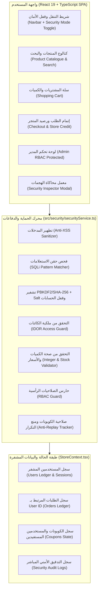

# 🛡️ SecureShop - CET431 Software Security Project (Phase 1)

> **Department of Computer Engineering Technology**  
> **Elsewedy University of Technology (POLYTECHNIC OF EGYPT)**  
> **Course:** CET431 - Software Security | Fall 2026  
> **Milestone:** Project Phase 1 Submission & Week 10 Oral Discussion (5 Marks)

---

## 📋 نظرة عامة على المشروع (Project Overview)

**SecureShop** هو تطبيق متجر إلكتروني مصمم ومبني خصيصاً لتلبية متطلبات مادة أمن البرمجيات (CET431). يجمع المشروع بين تلبية كافة الوظائف التجارية (Functional Requirements) وحمايتها ضد جميع الثغرات والهجمات الأمنية المعتمدة في المنهج (Security Requirements)، مع إمكانية التبديل التفاعلي المباشر بين **الوضع الآمن (SecureShop Defenses)** و**الوضع الساذج (Naive Implementation)** لإثبات نجاح الهجوم وفشله في مناقشة الأسبوع العاشر.

---

## 👥 هيكل الفريق وتوزيع الأدوار (Team Roster - 6 Members)

وفقاً لاشتراطات المشروع، ينقسم الفريق المكون من 6 أفراد بالتساوي إلى فريقين (3 Blue Team و 3 Red Team):

### 🔵 Blue Team (Defenders & Developers)
1. **Blue Member 1 (Lead Architecture & RBAC):** هندسة النظام، جدار الصلاحيات (Role-Based Access Control)، وحماية لوحة الإدارة.
2. **Blue Member 2 (Cryptography & Authentication):** تشفير كلمات المرور (PBKDF2/SHA-256 + Salt)، نظام تأكيد الحسابات، وحماية الدخول ضد الـ Brute Force.
3. **Blue Member 3 (Data Sanitization & Business Logic):** تطهير المدخلات (Anti-XSS/SQLi)، حماية السلة من الكميات السالبة، تأمين كوبونات الخصم، وسداد رصيد المتجر (Store Credit).

### 🔴 Red Team (Penetration Testers & Attack Simulation)
4. **Red Member 1 (Injection & XSS Specialist):** صياغة واختبار حمولات XSS المتقدمة وحقن الاستعلامات في شريط البحث والمراجعات.
5. **Red Member 2 (Access Control & IDOR Specialist):** محاولات كسر صلاحيات الطلبات (IDOR)، التلاعب بمعرفات العملاء، والتصعيد الرأسي للصلاحيات.
6. **Red Member 3 (Business Logic & Parameter Tampering Specialist):** التلاعب بأسعار السلة والكميات السالبة، محاولات إعادة استخدام الكوبونات (Replay)، واستنزاف الأرصدة.

---

## 🔑 حسابات الاختبار والتقييم (Evaluation Test Accounts)

للتسهيل على لجنة التحكيم والمناقشة، تم تزويد النظام مسبقاً بثلاثة حسابات نموذجية جاهزة بضغطة زر واحدة من نافذة تسجيل الدخول:

| نوع الحساب (Account Role) | البريد الإلكتروني (Email) | كلمة المرور (Password) | حالة التأكيد | رصيد المتجر (Store Credit) |
|:---|:---|:---|:---:|:---:|
| **مدير نظام (Admin)** | `admin@secureshop.edu` | `Admin@123456` | ✅ مؤكد ومفعل | 10,000 ج.م |
| **عميل متجر (Normal User)** | `user@secureshop.edu` | `User@123456` | ✅ مؤكد ومفعل | 5,000 ج.م |
| **حساب قيد التأكيد (Pending)** | `newbie@secureshop.edu` | `New@123456` | ⏳ كود: `789012` | 1,000 ج.م |

---

## 🚀 تشغيل المشروع محلياً (Quick Start & Setup)

المشروع مبني باستخدام **React 19 + TypeScript + Vite**:

### 1. تثبيت الحزم (Install Dependencies)
```bash
npm install
```

### 2. تشغيل خادم التطوير (Run Dev Server)
```bash
npm run dev
```
افتح المتصفح على: `http://localhost:5173`

### 3. بناء النسخة الإنتاجية (Production Build)
```bash
npm run build
```

---

## 🏗️ نظرة عامة على المعمارية (One-Page Architecture Overview)



---

## 🎯 المتطلبات الوظيفية المنفذة بالكامل (Phase 1 Functional Requirements)

1. **التسجيل والمصادقة (Registration & Login):**
   - إنشاء حساب جديد مع فحص قوة كلمة المرور.
   - تأكيد الحساب برمز تحقق مكوّن من 6 أرقام (Account Confirmation).
   - تسجيل الدخول الآمن وتسجيل الخروج.
2. **كتالوج المنتجات (Product Catalogue):**
   - استعراض المنتجات وتصنيفاتها، البحث الفوري، والترتيب حسب السعر والتقييم، وصفحة التفاصيل والمواصفات.
3. **سلة المشتريات (Shopping Cart):**
   - إضافة وحذف وتعديل الكميات مع الاحتفاظ بالسلة طوال الجلسة (Session Persistence).
4. **الكوبونات والنشرة البريدية (Coupons & Newsletter):**
   - الاشتراك في النشرة البريدية يُصدر كوبون فوري `WELCOME15` (خصم 15%).
   - تطبيق كوبونات الخصم في صفحة الدفع وحساب نسبة التخفيض تلقائياً.
5. **الدفع والطلبات (Checkout & Orders):**
   - **الدفع برصيد المتجر (Pay with Store Credit)** كخيار أساسي وخصم المبلغ من محفظة العميل فورياً.
   - الدفع عند الاستلام (COD)، إصدار الفاتورة وتتبع مسار الشحنة.
6. **صفحة الملف الشخصي (User Account Page):**
   - استعراض وتعديل البيانات الشخصية، عرض الرصيد المتاح، تغيير كلمة المرور، واستعراض فواتير وسجل طلبات العميل الخاص فقط.
7. **لوحة تحكم المدير (Admin Panel):**
   - إدارة المستخدمين (تعديل الرتب، الأرصدة، وتفعيل الحسابات).
   - إدارة المنتجات (إضافة، تعديل، حذف).
   - إدارة كوبونات الخصم ومتابعة سجلات الاستخدام.
8. **سهولة الاستخدام والتصميم (Usability):**
   - تصميم متجاوب 100% مع الهواتف والشاشات الكبيرة، رسائل خطأ وتنبيهات أمنية توضيحية واضحة.

---

## 🛡️ مصفوفة التغطية الأمنية المعتمدة (Security Coverage Matrix)

| الكود | الموضوع الأمني (Course Topic) | سيناريو الهجوم في SecureShop | السبب الجذري في التطبيق الساذج | الدفاع المطبق في SecureShop | مكان الكود |
|:---:|:---|:---|:---|:---|:---|
| **SEC-01** | **Stored & Reflected XSS** | حقن نصوص برمجية خبيثة في البحث أو مراجعات المنتجات | إدراج المدخلات بالواجهة مباشرة دون ترميز | ترميز وتطهير الأحرف عبر `sanitizeHtml` | `src/security/securityService.ts` |
| **SEC-02** | **SQL / Search Injection** | حقن استعلامات مثل `' OR '1'='1` لكسر فلترة المنتجات | الدمج النصي غير المفحوص للمدخلات | فحص المدخلات بـ Whitelist وتطهير الرموز الخاصة | `src/security/securityService.ts` |
| **SEC-03** | **Broken Authentication & Brute Force** | تخمين كلمات المرور بهجوم القوة الغاشمة السريع | غياب قفل الحساب واستخدام تجزئة ضعيفة | تشفير PBKDF2/Salt وقفل الحساب 60 ثانية بعد 5 محاولات | `StoreContext.tsx` & `securityService.ts` |
| **SEC-04** | **Insecure Direct Object Reference (IDOR)** | تغيير رقم الطلب `#DK-1001` لسرقة فواتير وعناوين عملاء آخرين | غياب التحقق من ملكية المستخدم للطلب في الطلب | فحص صارم لـ `order.userId === currentUser.id` مع `403` | `securityService.ts` (validateOrderAccess) |
| **SEC-05** | **Business Logic: Negative Quantities** | إدخال كمية سالبة `-5` في السلة لتخفيض الإجمالي أو كسب رصيد | قبول أي أرقام من العميل دون التحقق من كونها موجبة | التحقق الصارم في `validateCartQuantity` وحظر القيم السالبة | `securityService.ts` & `StoreContext.tsx` |
| **SEC-06** | **Coupon Abuse & Replay Attack** | إعادة استخدام كود الخصم الترحيبي `WELCOME15` مراراً | عدم تسجيل هوية المستخدمين المستفيدين من الكوبون | تتبع مصفوفة `usedByUsers` وتحديد استخدامه لمرة واحدة | `securityService.ts` (validateCouponSecurity) |
| **SEC-07** | **Broken Access Control & Privilege Escalation** | دخول مستخدم عادي أو زائر للوحة المدير `/admin` | الاعتماد على إخفاء الروابط في الواجهة فقط | جدار حماية صارم (RBAC Guard) يفحص `currentUser.role === 'admin'` | `AdminDashboard.tsx` & `securityService.ts` |

---

## 🧪 طريقة العرض التفاعلي في مناقشة الأسبوع العاشر (Live Demo Guide)

1. افتح الموقع، ستجد شريطاً علوياً يحتوي على **مفتاح تبديل وضع الأمان**:
   - **الوضع الآمن (🛡️ SecureShop Mode):** جميع الدفاعات نشطة.
   - **الوضع الساذج (⚠️ Naive Mode):** يتم تعطيل الدفاعات مؤقتاً لتوضيح الثغرة للأساتذة.
2. اضغط على زر **"معمل الأمان والمصفوفة"** في شريط التنقل العلوي:
   - تبويب **"مصفوفة التغطية الأمنية"**: يعرض الجدول الأكاديمي الشامل لكل ثغرة ودفاعها ومكانها في الكود.
   - تبويب **"معمل محاكاة الهجمات المباشرة"**: اضغط على زر **"اختبار الهجوم"** بجانب أي ثغرة لمشاهدة استجابة النظام الفورية أمام الممتحنين.
   - تبويب **"سجل التدقيق الأمني"**: يعرض الأحداث الأمنية والهجمات المحجوبة فورياً مع الـ Payload والتوقيت.
3. تجربة الدفع برصيد المتجر:
   - سجل الدخول بحساب العميل الافتراضي (`user@secureshop.edu`).
   - لاحظ ظهور رصيدك المتاح (5,000 ج.م).
   - أضف منتجات للسلة واشترك بالنشرة البريدية للحصول على كود `WELCOME15`.
   - اذهب لصفحة الدفع، طبق الكوبون، واختر **"الدفع برصيد المتجر (Store Credit)"**.
   - يتم خصم المبلغ من رصيدك فورياً وحفظ الفاتورة في صفحة حسابك الشخصي (المحمية من ثغرات IDOR).

---

## 📑 تقارير ومستندات المرحلة الأولى (Phase 1 Documentation Files)

تجد كافة التقارير التفصيلية المرفوعة للمشروع داخل مجلد `docs/`:
- 📄 [تقرير التصميم الأمني ونمذجة التهديدات (Security Design Report)](./docs/Phase1_Security_Design_Report.md)
- 📄 [تقرير أدلة الهجوم ومقارنة التطبيق الساذج بالآمن (Attack Evidence Report)](./docs/Phase1_Attack_Evidence_Report.md)
- 📄 [تقرير اختبار الاختراق المتبادل للفريق الأحمر (Red Team Penetration Test Report)](./docs/Phase1_Red_Team_Penetration_Test.md)
