# 📋 Software Requirements Specification (SRS)
## SecureShop E-Commerce System — Phase 1 Baseline

> **Institution:** Elsewedy University of Technology (Polytechnic of Egypt)  
> **Faculty:** Department of Computer Engineering Technology  
> **Course:** CET431 — Software Security | Fall 2026  
> **Milestone:** Project Phase 1 Submission & Week 10 Oral Defense (5 Marks)  
> **Document Identifier:** `SEC-SRS-2026-PH1-V1.0`  
> **Developer:** Osama Mohamed Moawad Zaytoun (Student ID: 230105355)  
> **Implementation Mode:** Individual Project Implementation (Course standard team size: 6; subject to instructor approval)  

---

## 1. Project Overview & Context

### 1.1 Project Title & Nomenclature
- **Official System Name:** `SecureShop`
- **Application Repository & Codebase Package:** `dukkan` (Private Package, Version `0.0.0`)
- **Target Deployment Context:** Localized E-Commerce Application tailored for the Egyptian domestic market (operating with Egyptian Pounds `EGP`, 24 Egyptian governorates, localized Arabic interface with English technical logging, and integration readiness for dropshipping models like Taager).

### 1.2 Core Concept & Business Intent
**SecureShop** is an enterprise-grade digital storefront engineered from the ground up to solve the dual challenges of commercial retail capability and defensive software engineering. Unlike generic template stores, SecureShop was designed with a dual-mode comparative security engine (**SecureShop Mode** vs. **Naive Implementation Mode**). This architecture allows academic examiners, instructors, and security assessors to observe both:
1. How real-world attack vectors (e.g., Cross-Site Scripting, SQL Injection, Credential Stuffing, IDOR, Negative Quantity Manipulation, and Coupon Replay) succeed against unhardened code.
2. How comprehensive software security defenses neutralize these threats in real time with automated audit logging.

### 1.3 Problem Statement
The modern web application landscape is saturated with vulnerable e-commerce deployments. Developers frequently introduce catastrophic vulnerabilities through common omissions:
- **Direct String Concatenation & Inadequate Sanitization:** Resulting in Stored and Reflected XSS that exposes customer session cookies and sensitive tokens.
- **Flawed Business Logic:** Blindly trusting numerical inputs submitted from client browsers, enabling attackers to inject negative quantities (`-5`) or fractional numbers to artificially diminish checkout totals or create fraudulent store credits.
- **Broken Object-Level Authorization (BOLA / IDOR):** Allowing unauthorized users to view invoices, phone numbers, and home addresses of third-party customers simply by enumerating sequential order IDs (`#DK-1001`).
- **Inadequate Credential Protection:** Storing passwords using fast, unsalted hashing algorithms (or plaintext), without account lockout thresholds to combat credential stuffing and automated brute-force attacks.
- **State Manipulation & Coupon Exploitation:** Failure to tie promotional discount codes to single-use identities, leading to unauthorized coupon replay and revenue loss.

### 1.4 Objectives & Course Alignment
This project directly satisfies the pedagogical objectives of **CET431 - Software Security**:
- **Application of Cryptographic Primitives:** Enforcing standard Web Cryptography API primitives (PBKDF2 with SHA-256 and 100,000 derivation rounds, combined with 16-byte cryptographically secure random salts).
- **Enforcement of Least Privilege & RBAC:** Implementing strict Role-Based Access Control dividing regular customers from administrative staff.
- **Defense-in-Depth Implementation:** Establishing defenses across presentation layers, client validation handlers, business logic controllers, and database access routines.
- **Empirical Attack Verification:** Demonstrating comparative test evidence for each topic taught up to Week 9 of the academic semester.

---

## 2. User Roles & Access Hierarchy

The system defines three mutually exclusive security actors:

```mermaid
graph TD
    User([External Actor]) -->|Unauthenticated| Guest[Guest / Anonymous Visitor]
    User -->|Valid Credentials| AuthUser[Registered Customer / User]
    User -->|Admin Credential admin@secureshop.edu| Admin[System Administrator]

    Guest -->|Browse & Search| Catalog[Product Catalogue]
    Guest -->|Add to Session| Cart[Cart Drawer]
    Guest -->|Restricted Tracking| Track[Order Tracking / Phone Required]

    AuthUser -->|Full Access| Catalog
    AuthUser -->|Personal Wallet| Credit[Store Credit Management]
    AuthUser -->|Checkout & Orders| Orders[Order History & Invoices]
    AuthUser -->|Single-Use| Coupon[Welcome Coupon WELCOME15]
    AuthUser -->|Profile Settings| Profile[Password Change & Address]

    Admin -->|Full Store Operations| Dash[Admin Dashboard /admin]
    Admin -->|CRUD| ProdMgmt[Product Management]
    Admin -->|Audit & Status| OrderMgmt[Order Management & Deletion]
    Admin -->|Credit Adjustments| UserMgmt[User Management & Deletion]
    Admin -->|Promotions| CouponMgmt[Coupon Creation & Toggling]
    Admin -->|Restricted| NoShop[No Customer Shopping / Protected Account]
```

### 2.1 Role 1: Guest (Unauthenticated Visitor)
- **Authentication State:** `currentUser === null`.
- **Allowed Actions:**
  - View public landing page, hero banner, category pills, and product catalog.
  - Filter products by category, sort by price (low/high) or customer ratings.
  - Search products with keyword filtering (intercepted by input validation).
  - Inspect product details, image carousel, features, and specifications via `ProductDetailModal`.
  - Add items to the shopping cart drawer (`CartDrawer`) with session persistence.
  - Attempt order tracking via `OrderTrackingModal` (must provide exact matching customer phone number).
- **Explicit Restrictions & Guards:**
  - Cannot complete checkout using Store Credit (credit wallet unavailable).
  - Cannot access the administrative dashboard (`/admin`); blocked by RBAC guard.
  - Cannot claim the single-use newsletter welcome coupon; prompted to register/login first.
  - Cannot view private user profile or historical customer order ledgers.

### 2.2 Role 2: Registered User (`role: 'user'`)
- **Authentication State:** `currentUser !== null` and `currentUser.role === 'user'`.
- **Identity Attributes:** Unique UUID (`id`), confirmed email address (`email`), customer full name, hashed password, unique salt, verification state (`isConfirmed`), and financial wallet (`storeCredit`).
- **Allowed Actions:**
  - All Guest capabilities.
  - Authenticate securely via email and password with brute-force lockout defense.
  - Confirm account registration using the 6-digit confirmation code.
  - Maintain a persistent digital store credit balance in Egyptian Pounds (`EGP`).
  - Claim the single-use newsletter discount coupon (`WELCOME15`) strictly bound to their registered email.
  - Apply promotional coupon codes during checkout with anti-replay tracking.
  - Complete checkout using Store Credit (atomic balance deduction) or Cash on Delivery (COD).
  - View and track personal orders in `UserProfileModal` and `OrderTrackingModal` without IDOR exposure.
  - Update personal shipping information (governorate, city, street address, mobile phone).
  - Change account password (requires current password verification and re-hashes using PBKDF2/Salt).
- **Explicit Restrictions & Guards:**
  - Cannot self-recharge store credit wallet (recharge button disabled; credit modifications restricted to Admin).
  - Cannot access `AdminDashboard` (intercepted by `validateAdminAccess`, displaying a `403 Forbidden` alert).
  - Cannot promote own account or other users to administrative roles.
  - Cannot claim the newsletter coupon more than once or using an email differing from their own account.
  - Cannot view, inspect, or tamper with orders belonging to other user accounts.

### 2.3 Role 3: System Administrator (`role: 'admin'`)
- **Authentication State:** `currentUser !== null`, `currentUser.role === 'admin'`, specifically anchored to the protected institutional administrator identity: `admin@secureshop.edu`.
- **Allowed Actions:**
  - Access the comprehensive administrative control panel (`AdminDashboard`).
  - Monitor real-time financial KPIs (Total Gross Revenue, Net Dropshipping Profit, Total Orders, Delivery Success Rate, Average Order Value).
  - **Product Management:** Create new product listings, edit descriptions/pricing/stock, toggle active visibility, and delete products (`ProductManager`).
  - **Order Management:** View global order pipeline, update delivery fulfillment status (`pending` -> `confirmed` -> `processing` -> `shipped` -> `delivered` -> `cancelled`), and permanently delete customer orders (`OrderManager`).
  - **User Management:** Inspect customer registry, toggle account activation state, adjust customer store credit balances, and permanently delete non-admin accounts (`UserManager`).
  - **Coupon Management:** Create new percentage discount coupons, set expiration timestamps, define minimum order limits and maximum discount caps, and toggle active states (`CouponManager`).
  - Delete customer orders and customer accounts directly from local state and Supabase remote PostgreSQL.
- **Explicit Restrictions & Architectural Guards:**
  - **Sole Admin Rule:** The administrator account is completely protected against role demotion, role transfer, and deletion (`حساب محمي 🛡️`).
  - **Non-Customer Separation:** Administrative accounts are prevented from generating shopping carts, claiming consumer welcome coupons, or self-recharging store credit.
  - The newsletter subscription widget is completely suppressed and hidden when logged in as Admin.

---

## 3. Functional Requirements (FR)

### 3.1 Group A: Course-Mandated Functional Requirements

#### FR-01: User Registration
- **Description:** Enables new customers to register a personal account.
- **Inputs:** Full Name (`string`), Email Address (`string`), Password (`string`).
- **Processing Logic:**
  1. Validates input formatting: Name must be non-empty, email must match standard email RFC structure, password length must be $\ge 6$ characters.
  2. Verifies uniqueness of email address against the user registry (case-insensitive comparison).
  3. Generates a cryptographically random 16-byte hex salt via `crypto.getRandomValues`.
  4. Computes password digest using PBKDF2 (SHA-256, 100,000 iterations).
  5. Generates a random 6-digit account confirmation code (e.g., `123456`).
  6. Assigns an initial welcome balance of 1,000 EGP store credit (`storeCredit: 1000`).
  7. Sets account confirmation status to `isConfirmed: false`.
  8. Synchronizes the newly minted user record to both LocalStorage and remote Supabase PostgreSQL (`public.users`).
- **Code Trace:** `src/components/auth/AuthModal.tsx` (`handleRegisterSubmit`), `src/context/StoreContext.tsx` (`registerUser`).

#### FR-02: Account Confirmation Token Verification
- **Description:** Enforces email verification via a 6-digit confirmation token prior to allowing authenticated sessions.
- **Inputs:** Registered Email (`string`), 6-Digit Token (`string`).
- **Processing Logic:**
  1. Matches target account by normalized email address.
  2. Compares supplied token against `user.confirmationCode`.
  3. Upon match, updates `user.isConfirmed = true` and clears `confirmationCode`.
  4. Propagates verified state to database.
- **Code Trace:** `src/components/auth/AuthModal.tsx` (`handleConfirmSubmit`), `src/context/StoreContext.tsx` (`confirmAccount`).

#### FR-03: User Authentication & Login Protection
- **Description:** Authenticates returning customers and administrators while defending against brute-force attacks.
- **Inputs:** Email Address (`string`), Plaintext Password (`string`).
- **Processing Logic:**
  1. Intercepts submission; normalizes email (`trim().toLowerCase()`).
  2. Searches user registry. If unconfirmed, prompts for 6-digit confirmation token.
  3. Checks account lockout status: If `user.isLocked === true` and `user.lockUntil > Date.now()`, aborts authentication and displays remaining lockout seconds.
  4. Computes PBKDF2 hash of input password using the target user's stored `salt`.
  5. Compares computed hash with stored `passwordHash`.
  6. If password matches: Resets `failedAttempts = 0`, clears lockout state, establishes active session in `currentUser`, and persists session token.
  7. If password mismatches: Increments `user.failedAttempts`. If failures reach threshold (5 attempts in Secure mode), triggers account lockout for 60 seconds (`lockUntil = Date.now() + 60000`) and logs a `Brute Force Attack (Blocked)` security audit event.
- **Code Trace:** `src/context/StoreContext.tsx` (`login`), `src/security/securityService.ts` (`hashPasswordSecure`).

#### FR-04: User Logout & Session Invalidation
- **Description:** Terminates current authenticated session.
- **Processing Logic:** Clears `currentUser` state, invalidates session storage (`secureshop_session_email`), resets view to `'store'`, and sets `secureshop_logged_out` flag to prevent unauthorized automatic session restoration on browser refresh.
- **Code Trace:** `src/context/StoreContext.tsx` (`logout`).

#### FR-05: Product Catalogue Browsing
- **Description:** Renders retail merchandise with high-fidelity commercial presentation.
- **Attributes Displayed:** Arabic title, product image, category badge, current retail price (`sellingPrice`), original anchor price (`originalPrice`), discount percentage badge, live inventory status (`stock`), customer review score (`rating`), and promotional deal tags (`dealBadge`).
- **Responsive Layout:** Automatically formats into a 2-column e-commerce grid on mobile viewports ($\le 640\text{px}$) and 3/4 columns on desktop.
- **Code Trace:** `src/components/customer/ProductCard.tsx`, `src/components/customer/ProductDetailModal.tsx`.

#### FR-06: Product Search with Whitelist Query Sanitization
- **Description:** Real-time catalog search filtering items by title, description, and feature specifications.
- **Defensive Logic:** The search input passes through `validateSearchQuery` (`securityService.ts`). Inputs containing SQL meta-characters or injection signatures (`'`, `--`, `;`, `UNION SELECT`, `OR 1=1`) are intercepted, stripped of illegal tokens, and audited in the Security Inspector.
- **Code Trace:** `src/App.tsx` (`filteredProducts`), `src/security/securityService.ts` (`validateSearchQuery`).

#### FR-07: Shopping Cart Management & Session State
- **Description:** Slide-out drawer allowing customers to aggregate items, adjust quantities, and review order subtotal.
- **Validation Rules:**
  - Quantity modifications pass through `validateCartQuantity`.
  - Rejects negative numbers (`-1`), zero (`0`), floating-point values, and quantities exceeding available inventory (`stock`).
  - Persists across browser tab reloads via transient session storage.
- **Code Trace:** `src/components/customer/CartDrawer.tsx`, `src/context/StoreContext.tsx` (`addToCart`, `updateCartQuantity`, `removeFromCart`).

#### FR-08: Promotional Coupon Verification & Anti-Replay
- **Description:** Applies discount vouchers to order subtotals with single-use per customer enforcement.
- **Processing Logic:**
  1. Searches coupon registry by code (case-insensitive).
  2. Validates `coupon.isActive === true`.
  3. Validates expiration: `coupon.expiryDate > new Date().toISOString()`.
  4. Validates minimum order threshold: `subtotal >= coupon.minOrderAmount`.
  5. Enforces single-use constraint: If `coupon.isSingleUsePerUser === true`, checks whether `coupon.usedByUsers.includes(currentUser.id)`. Rejects re-use attempts with explicit error (`Coupon Replay Blocked`).
  6. Computes discount with upper limit cap: $\min(\text{subtotal} \times \frac{\text{discountPercent}}{100}, \text{maxDiscount})$.
- **Code Trace:** `src/security/securityService.ts` (`validateCouponSecurity`), `src/context/StoreContext.tsx` (`applyCoupon`).

#### FR-09: Newsletter Subscription & Strict Email Binding
- **Description:** Issues immediate 15% promotional coupon (`WELCOME15`) to subscribers.
- **Security Rules:**
  1. Suppressed completely if logged-in user is `admin`.
  2. Requires customer to be authenticated.
  3. Enforces strict email binding: The input email must identically match the logged-in customer's registered email (`cleanEnteredEmail === cleanUserEmail`). Any attempt to enter an external email is blocked as an unauthorized coupon bypass.
  4. Limits issuance to exactly once per account (`hasClaimedNewsletter` check).
- **Code Trace:** `src/components/customer/NewsletterSection.tsx`, `src/context/StoreContext.tsx` (`subscribeNewsletter`).

#### FR-10: Store Credit Payment Settlement
- **Description:** Allows registered customers to settle purchases using their digital wallet balance in EGP.
- **Processing Logic:**
  1. Validates that customer balance $\ge$ order total.
  2. Deducts order total from `currentUser.storeCredit`.
  3. Updates user's record in local state and Supabase database.
  4. Marks payment method as `store_credit` and records transaction in order history.
- **Code Trace:** `src/components/customer/CheckoutModal.tsx`, `src/context/StoreContext.tsx` (`createOrder`).

#### FR-11: Order Placement & Order Receipt
- **Description:** Finalizes checkout, creates persistent order ledger, updates stock counts, and generates customer receipt.
- **Inputs:** Customer Name, Phone Number, Governorate, City, Detailed Address, Payment Method (`cod` or `store_credit`).
- **Processing Logic:**
  1. Free shipping applied across all 24 Egyptian governorates (`shippingCost: 0`).
  2. Assigns unique human-readable tracking number (e.g., `#DK-1002`).
  3. Binds immutable `userId = currentUser.id` to prevent IDOR vulnerabilities.
  4. Depletes product inventory by purchased quantities.
  5. Records redeemed coupon ID in `coupon.usedByUsers`.
  6. Writes order to database (`public.orders`).
- **Code Trace:** `src/components/customer/CheckoutModal.tsx`, `src/context/StoreContext.tsx` (`createOrder`).

#### FR-12: Order Tracking & IDOR Access Defense
- **Description:** Allows customers to query tracking timeline and invoice receipts.
- **Authorization Guard:**
  - Query passes through `validateOrderAccess`.
  - Non-owners are denied access (`403 Forbidden`). Only the order creator (`order.userId === currentUser.id`), verified phone match, or an administrator can inspect order details.
- **Code Trace:** `src/components/customer/OrderTrackingModal.tsx`, `src/security/securityService.ts` (`validateOrderAccess`).

#### FR-13: User Profile & Self-Service Account Management
- **Description:** Customer dashboard displaying available store credit, personal order history, address details, and password updating.
- **Security Logic:** Password change requires verifying the old password via PBKDF2 before computing a fresh salt and hash for the new password.
- **Code Trace:** `src/components/customer/UserProfileModal.tsx`.

#### FR-14: Admin Dashboard & RBAC Guard
- **Description:** Protected management panel accessible only to users with role `admin`.
- **RBAC Logic:** If an unauthenticated user or non-admin customer attempts to open the dashboard, `validateAdminAccess` halts rendering, displays a `403 Access Denied` screen, and logs a security violation.
- **Code Trace:** `src/components/admin/AdminDashboard.tsx`, `src/security/securityService.ts` (`validateAdminAccess`).

#### FR-15: Administrative User Management
- **Description:** Panel enabling administrators to view registered accounts, toggle active/suspended status, modify store credit balances, and permanently delete accounts.
- **Protection Rule:** The sole administrator account (`admin@secureshop.edu`) cannot be deleted, suspended, demoted, or credited.
- **Code Trace:** `src/components/admin/UserManager.tsx`.

#### FR-16: Administrative Product Management
- **Description:** Complete CRUD interface for the retail catalog (Create, Read, Update, Delete, and Toggle Active Status).
- **Code Trace:** `src/components/admin/ProductManager.tsx`.

#### FR-17: Administrative Coupon Management
- **Description:** Enables administrators to generate promotional coupons, define percentage discounts, caps, order minimums, expiration dates, and delete coupons.
- **Code Trace:** `src/components/admin/CouponManager.tsx`.

---

### 3.2 Group B: Extended Non-Standard Features (Project Enhancements)

1. **Free Shipping Architecture across Egypt:** All 24 Egyptian governorates have been configured with zero shipping fees (`shippingCost: 0`), streamlining checkout while preserving accurate delivery timeframe estimations (1–3 days).
2. **Taager Dropshipping Financial Engine:** Data model supports `taagerPrice` and calculates estimated net profit (`estimatedProfit = subtotal - totalTaagerCost`), empowering administrators with live commercial profit analytics.
3. **Multi-Tab Cross-Storage Synchronization:** Real-time window `storage` event listeners ensure that credit changes or cart modifications performed in one browser tab synchronize instantly with all open tabs without requiring full-page reload.
4. **Interactive Security Demonstration Hub & Simulator:** An on-screen modal (`SecurityInspectorModal`) that allows instructors to toggle between **SecureShop Mode** and **Naive Mode**, review the course security matrix, trigger live simulated attacks, and inspect real-time audit logs.
5. **Mobile-First Responsive Engineering:** Full optimization for iOS Safari and Android Chrome, including auto-zoom suppression via `16px` font thresholds, 2-column e-commerce grid, and touch-optimized drawer dialogs.

---

## 4. Non-Functional Requirements (NFR)

| NFR ID | Attribute | Specification & Quantitative Criteria |
|:---|:---|:---|
| **NFR-01** | **Security: Cryptography** | Passwords must be hashed using PBKDF2 with SHA-256, 100,000 iterations, and a unique 16-byte random salt generated via `crypto.getRandomValues`. Raw passwords must never be stored, logged, or serialized. |
| **NFR-02** | **Security: Sanitization** | All user-supplied input rendered in the DOM must undergo HTML entity encoding (`<` $\to$ `&lt;`, `>` $\to$ `&gt;`, `"` $\to$ `&quot;`, `'` $\to$ `&#x27;`, `/` $\to$ `&#x2F;`) to prevent Stored and Reflected XSS. |
| **NFR-03** | **Security: Access Control** | Authorization checks must be enforced at process boundaries: RBAC for administrative views and object-level verification for order queries to eliminate IDOR. |
| **NFR-04** | **Reliability & Availability** | Dual-tier storage resilience: The application must operate flawlessly using LocalStorage caching if remote Supabase PostgreSQL connectivity is blocked, degraded, or offline. |
| **NFR-05** | **Performance & Latency** | Product catalog filtering, searching, and sorting operations must execute client-side in under $50\text{ms}$ for up to 1,000 items. Vite production bundle size must remain optimized ($< 700\text{kB}$ uncompressed JavaScript). |
| **NFR-06** | **Usability & Localization** | Primary UI must feature fluent Modern Standard Arabic with Right-to-Left (RTL) layout direction, accompanied by clear visual state alerts and icons (`lucide-react`). |
| **NFR-07** | **Data Integrity** | Financial balance deductions (Store Credit) and inventory deductions must be atomic and non-negative. Quantities must strictly validate as positive non-zero integers. |
| **NFR-08** | **Device Compatibility** | Layout must be responsive across screen widths from $320\text{px}$ (mobile) to $2560\text{px}$ (4K monitors). Input elements on mobile devices must maintain `font-size: 16px` to prevent iOS auto-zooming. |

---

## 5. Requirements Traceability Matrix (RTM)

The matrix below maps each system requirement to its corresponding component, source code files, and implementation verification status:

| Req ID | Requirement Name | Priority | Responsible Component | Source File Reference | Implementation Status | Verification Method |
|:---:|:---|:---:|:---|:---|:---:|:---:|
| **FR-01** | User Registration | P0 | Auth Component | `src/components/auth/AuthModal.tsx` `src/context/StoreContext.tsx` | **Implemented** | Automated unit test & live registration |
| **FR-02** | Account Confirmation | P0 | Auth Component | `src/components/auth/AuthModal.tsx` `src/context/StoreContext.tsx` | **Implemented** | Verification code flow validation |
| **FR-03** | Authentication & Lockout | P0 | Security Service | `src/context/StoreContext.tsx` `src/security/securityService.ts` | **Implemented** | 5-attempt brute-force lock test |
| **FR-04** | User Logout | P0 | Layout / State | `src/components/layout/Navbar.tsx` `src/context/StoreContext.tsx` | **Implemented** | Session destruction inspection |
| **FR-05** | Product Catalogue | P0 | Customer Views | `src/components/customer/ProductCard.tsx` `src/data/initialProducts.ts` | **Implemented** | DOM inspection across viewports |
| **FR-06** | Product Search & Sanitization | P0 | Security Service | `src/App.tsx` `src/security/securityService.ts` | **Implemented** | Injection payload submission test |
| **FR-07** | Shopping Cart Validation | P0 | Cart Drawer | `src/components/customer/CartDrawer.tsx` `src/security/securityService.ts` | **Implemented** | Negative quantity submission test |
| **FR-08** | Coupon Security & Anti-Replay | P0 | Security Service | `src/security/securityService.ts` `src/context/StoreContext.tsx` | **Implemented** | Replay discount attempt validation |
| **FR-09** | Newsletter Single-Use Binding | P1 | Customer Views | `src/components/customer/NewsletterSection.tsx` `src/context/StoreContext.tsx` | **Implemented** | Strict email mismatch test |
| **FR-10** | Store Credit Settlement | P0 | Checkout Modal | `src/components/customer/CheckoutModal.tsx` `src/context/StoreContext.tsx` | **Implemented** | Wallet deduction transaction test |
| **FR-11** | Order Placement & Receipt | P0 | Checkout Modal | `src/components/customer/CheckoutModal.tsx` `src/services/supabaseService.ts` | **Implemented** | Supabase database record verification |
| **FR-12** | Order Tracking & IDOR Guard | P0 | Order Modal | `src/components/customer/OrderTrackingModal.tsx` `src/security/securityService.ts` | **Implemented** | Cross-customer order access test |
| **FR-13** | User Profile Management | P1 | Profile Modal | `src/components/customer/UserProfileModal.tsx` | **Implemented** | Password update & verify test |
| **FR-14** | Admin Dashboard & RBAC | P0 | Admin Views | `src/components/admin/AdminDashboard.tsx` `src/security/securityService.ts` | **Implemented** | Non-admin 403 access denial test |
| **FR-15** | User Management & Admin Protection | P0 | Admin Views | `src/components/admin/UserManager.tsx` `src/context/StoreContext.tsx` | **Implemented** | Protected admin row inspection |
| **FR-16** | Product Management CRUD | P1 | Admin Views | `src/components/admin/ProductManager.tsx` `src/services/supabaseService.ts` | **Implemented** | Add/edit/delete product test |
| **FR-17** | Coupon & Order Deletion | P1 | Admin Views | `src/components/admin/CouponManager.tsx` `src/components/admin/OrderManager.tsx` | **Implemented** | Admin order deletion verification |
| **NFR-01** | PBKDF2/SHA-256 Hashing | P0 | Security Service | `src/security/securityService.ts` | **Implemented** | WebCrypto API execution audit |
| **NFR-02** | Anti-XSS Entity Sanitization | P0 | Security Service | `src/security/securityService.ts` | **Implemented** | Malicious `<script>` payload test |
| **NFR-03** | IDOR Object Authorization | P0 | Security Service | `src/security/securityService.ts` | **Implemented** | Insecure direct reference probe |
| **NFR-04** | Supabase Database Persistence | P0 | Supabase Service | `src/services/supabaseService.ts` `src/context/StoreContext.tsx` | **Implemented** | Supabase PostgreSQL direct queries & Realtime |
| **NFR-05** | Responsive Mobile Layout | P1 | Global Stylesheet | `src/index.css` `src/components/layout/Navbar.tsx` | **Implemented** | Mobile viewport emulator testing |
| **NFR-06** | Real-Time Audit Logging | P1 | Security Inspector | `src/components/security/SecurityInspectorModal.tsx` | **Implemented** | Live event stream audit validation |

---

## 6. Document Sign-Off & Phase 1 Baseline Approval

This specification represents the formal requirements baseline for Phase 1 of the SecureShop software development lifecycle. All functional and non-functional requirements detailed herein are actively deployed and verified within the repository codebase.

- **Developer & Sole Author:** Osama Mohamed Moawad Zaytoun
- **Student ID:** 230105355
- **Academic Course:** CET431 — Software Security
- **Department:** Computer Engineering Technology, Elsewedy University of Technology
- **Evaluation Milestone:** University Oral Defense — Week 10
