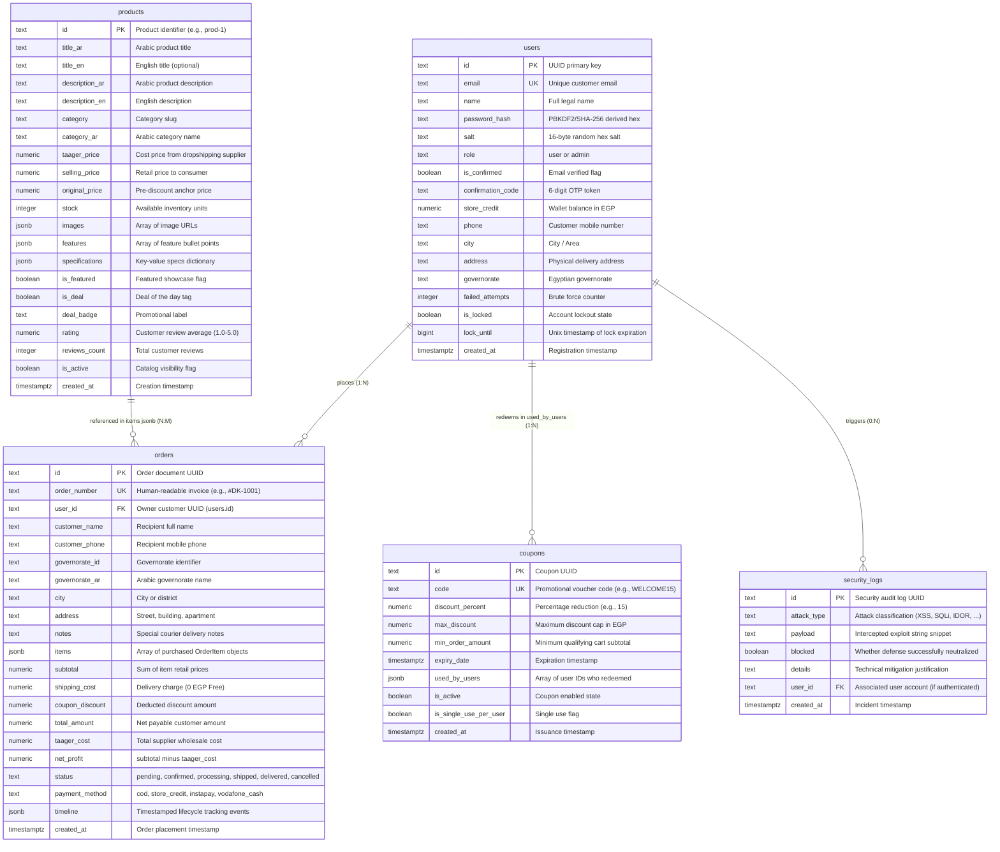

# 🏛️ System Architecture & Design Specification
## SecureShop E-Commerce System — Phase 1 Baseline

> **Institution:** Elsewedy University of Technology (Polytechnic of Egypt)  
> **Faculty:** Department of Computer Engineering Technology  
> **Course:** CET431 — Software Security | Fall 2026  
> **Milestone:** Project Phase 1 Submission & Week 10 Oral Defense (5 Marks)  
> **Document Identifier:** `SEC-ARCH-2026-PH1-V1.0`  
> **Artifact References:** Vector Diagrams in `docs/Phase1/diagrams/`  

---

## 1. Technology Stack Decomposition

A forensic inspection of the codebase configuration files (`package.json`, `tsconfig.json`, `vite.config.ts`, `.env`, and `scripts/setup-supabase.js`) reveals the exact technologies actively powering the SecureShop application:

```
+----------------------------------------------------------------------------------------------------+
|                                     TECHNOLOGY STACK SUMMARY                                       |
+--------------------------+---------------------------------------------+---------------------------+
| Layer                    | Technology / Library                        | Version & Role            |
+--------------------------+---------------------------------------------+---------------------------+
| Frontend Framework       | React (Single Page Application - SPA)       | v19.2.8 (Modern Concurrent)|
| Language & Typing        | TypeScript                                  | ~v6.0.2 (Strict Mode)     |
| Build Tool & Bundler     | Vite                                        | v8.3.0 (Fast HMR & Rollup)|
| CSS Architecture         | Pure CSS3 with Custom Properties & Grid     | Responsive Mobile-First   |
| Backend Architecture     | Backend-as-a-Service (BaaS) / Serverless     | Supabase Headless REST    |
| Database Engine          | PostgreSQL (Managed Supabase Cloud)         | Cloud Host: AWS EU-West-1 |
| DB Client & SDK          | @supabase/supabase-js                       | v2.119.2 (Direct REST/RPC)|
| Direct DB Driver (Admin) | pg (node-postgres)                          | v8.23.1 (Setup/Migrations)|
| Cryptographic Engine     | Web Cryptography API (crypto.subtle)        | PBKDF2/SHA-256 + Salt     |
| UI Icons & Visuals       | lucide-react                                | v1.45.0 (Vector Icons)    |
| Animation & Effects      | canvas-confetti                             | v1.9.4 (Reward Effects)   |
| Static Linter & QA       | oxlint                                      | v1.81.0 (Static Analysis) |
+--------------------------+---------------------------------------------+---------------------------+
```

### 1.1 Frontend Architecture
- **Single Page Application (SPA):** Built on React 19 and bundled via Vite. All client rendering, navigation, and view switching are managed in-memory without full document roundtrips.
- **State Management:** Centralized through React Context API (`StoreContext.tsx`), implementing a single source of truth for products, orders, cart items, active coupons, authenticated sessions, security logs, and operational modes.
- **Client Resilience:** Dual-tier caching strategy. LocalStorage mirrors all data structures (`STORAGE_KEYS`), enabling the application to continue functioning even if external database connections are firewalled or network connectivity is severed.

### 1.2 Backend & Data Persistence Architecture
- **Headless Database Architecture:** Direct interaction between the React client and the managed Supabase PostgreSQL instance using `@supabase/supabase-js`.
- **Database Endpoint:** `https://nojbpgdtlrcdyxsvmluh.supabase.co` connected through the public anon key (`sb_publishable_g8qFBCfqxyza6W2p0aIIkg_PEyxfmdl`).
- **Administrative Database Scripting:** Direct administrative migrations and seeding script located in `scripts/setup-supabase.js`, utilizing the native `pg` driver over SSL to `aws-1-eu-west-1.pooler.supabase.com:6543`.

### 1.3 Authentication & Authorization Subsystems
- **Client-Side Cryptographic Provider:** Passwords are never transmitted in plaintext. Authentication derives cryptographic keys locally using the standard browser `crypto.subtle` API via PBKDF2 (100,000 iterations, SHA-256, and random 16-byte salts).
- **Session Model:** Client-persisted session containing the sanitized user object, stored under `STORAGE_KEYS.CURRENT_USER`.
- **Authorization Engine:** Role-Based Access Control (`role: 'admin' | 'user'`) combined with Context-Aware Object Ownership verification (`order.userId === currentUser.id`) in `src/security/securityService.ts`.

---

## 2. High-Level Architecture Diagram & Trust Boundaries

The system architecture is organized into four distinct horizontal tiers separated by three critical **Trust Boundaries (TB)**:

```mermaid
flowchart TD
    subgraph ExternalZone["Zone 0: External Actors"]
        Actor_Guest["Guest User<br/>(Anonymous / Untrusted)"]
        Actor_User["Registered Customer<br/>(Authenticated User)"]
        Actor_Admin["Administrator<br/>(admin@secureshop.edu)"]
        Actor_Attacker["Malicious Adversary<br/>(XSS / SQLi / Brute Force)"]
    end

    TB1["=================== TRUST BOUNDARY 1: Untrusted Input / DOM Boundary ==================="]

    subgraph ClientTier["Zone 1: Client Presentation Layer (React 19 SPA)"]
        UI_Nav["Navbar & Mode Switch<br/>(src/components/layout/Navbar.tsx)"]
        UI_Catalog["Product Grid & Modal<br/>(src/components/customer/ProductCard.tsx)"]
        UI_Cart["Cart Drawer<br/>(src/components/customer/CartDrawer.tsx)"]
        UI_Checkout["Checkout & Payment<br/>(src/components/customer/CheckoutModal.tsx)"]
        UI_Auth["Auth & Confirm Modal<br/>(src/components/auth/AuthModal.tsx)"]
        UI_Admin["Admin Panel<br/>(src/components/admin/AdminDashboard.tsx)"]
        UI_SecHub["Security Inspector Hub<br/>(src/components/security/SecurityInspectorModal.tsx)"]
    end

    TB2["=================== TRUST BOUNDARY 2: Validated Logic & Security Gate ==================="]

    subgraph SecurityTier["Zone 2: Security & Defense Interceptors (src/security/securityService.ts)"]
        SEC_XSS["Anti-XSS Sanitizer<br/>sanitizeHtml()"]
        SEC_SQL["SQLi Interceptor<br/>validateSearchQuery()"]
        SEC_AUTH["PBKDF2/Salt Cryptography<br/>hashPasswordSecure() & Lockout"]
        SEC_IDOR["IDOR Access Guard<br/>validateOrderAccess()"]
        SEC_BIZ["Business Logic Guard<br/>validateCartQuantity() & Integer Check"]
        SEC_RBAC["RBAC Admin Guard<br/>validateAdminAccess()"]
        SEC_COUPON["Anti-Replay Tracker<br/>validateCouponSecurity()"]
    end

    subgraph StateTier["Zone 3: State & Business Logic Layer (src/context/StoreContext.tsx)"]
        CTX_Store["StoreProvider Central Engine"]
        CTX_Products["Products State & Stock"]
        CTX_Cart["Cart State & Calculations"]
        CTX_Auth["Auth Session & Lockout Timers"]
        CTX_Orders["Order Settlement & Store Credit"]
        CTX_Logs["Security Audit Trail (security_logs)"]
    end

    TB3["=================== TRUST BOUNDARY 3: Client-to-Database Gateway (Anon Key) ==================="]

    subgraph DatabaseTier["Zone 4: Remote Persistence Layer (Supabase PostgreSQL Cloud)"]
        DB_SupaClient["Supabase Client SDK (supabaseService.ts)"]
        DB_Users["public.users<br/>(PK: id, UQ: email, Salt, Hash)"]
        DB_Products["public.products<br/>(PK: id, Prices, Stock, Specs)"]
        DB_Orders["public.orders<br/>(PK: id, user_id FK, Items, Status)"]
        DB_Coupons["public.coupons<br/>(PK: id, Code, used_by_users jsonb)"]
        DB_Logs["public.security_logs<br/>(PK: id, AttackType, Payload, Audit)"]
    end

    ExternalZone --> TB1
    TB1 --> ClientTier
    ClientTier --> TB2
    TB2 --> SecurityTier
    SecurityTier --> StateTier
    StateTier --> TB3
    TB3 --> DatabaseTier

    classDef redZone stroke:#ef4444,stroke-width:2px;
    classDef blueZone stroke:#3b82f6,stroke-width:2px;
    classDef greenZone stroke:#10b981,stroke-width:2px;
    classDef purpleZone stroke:#8b5cf6,stroke-width:2px;

    class ExternalZone redZone;
    class ClientTier blueZone;
    class SecurityTier greenZone;
    class DatabaseTier purpleZone;
```



> **Detailed Architecture Vector Graphic:** A scalable SVG diagram is available at `docs/Phase1/diagrams/architecture_overview.svg`.

### 2.1 Description of Trust Boundaries (TB)

#### Trust Boundary 1: Untrusted Input / DOM Boundary (External $\to$ Client)
- **Separation:** Divides external users, network inputs, and malicious browser manipulation from internal JavaScript application memory.
- **Threats at this Boundary:** Cross-Site Scripting (Reflected & Stored), SQL/Query Injection, parameter tampering (negative quantities), credential stuffing.
- **Defensive Checkpoints:**
  - `sanitizeHtml()` encodes HTML entities (`<` $\to$ `&lt;`, `>` $\to$ `&gt;`).
  - `validateSearchQuery()` intercepts SQL keywords prior to memory filtering.
  - Strict input masks and regex validations on registration and checkout forms.

#### Trust Boundary 2: Security & Business Logic Interception (UI $\to$ State)
- **Separation:** Divides user-initiated UI actions from the core application state (`StoreContext.tsx`).
- **Threats at this Boundary:** Business logic bypasses, coupon replay, IDOR order access, unauthorized administrative privilege escalation.
- **Defensive Checkpoints:**
  - `validateCartQuantity()` enforces integer constraints and stock ceilings.
  - `validateOrderAccess()` enforces that `order.userId === currentUser.id`.
  - `validateAdminAccess()` blocks non-admin users from rendering administrative controls.
  - `validateCouponSecurity()` inspects `coupon.usedByUsers` to prevent re-use.

#### Trust Boundary 3: Client-to-Database Gateway (Client $\to$ Supabase)
- **Separation:** Divides the client browser runtime from the remote Supabase PostgreSQL database.
- **Communication Protocol:** HTTPS / REST over TLS 1.3 via PostgREST.
- **Authentication Method:** Supabase Anon Key.
- **Architectural Observation:** Because database operations utilize the public anon key without server-side proxy middleware, database security relies heavily on client-side security interceptors. (Refer to Section 3.3 for Row-Level Security analysis).

---

## 3. Database Design & Relational Schema

The database schema is defined in PostgreSQL on Supabase Cloud. It consists of 5 core relational tables:



> **Detailed Database Schema Vector Graphic:** A scalable SVG diagram is available at `docs/Phase1/diagrams/erd_database.svg`.

### 3.1 Primary & Foreign Key Specifications

1. **`public.users`:**
   - **Primary Key:** `id` (`text`, UUID format).
   - **Unique Constraints:** `email` (`text`, case-insensitive uniqueness).
   - **Relationships:** One-to-many relationship with `public.orders` via `orders.user_id`. One-to-many relationship with `public.coupons` via JSON array inclusion in `coupons.used_by_users`.
2. **`public.products`:**
   - **Primary Key:** `id` (`text`, e.g., `'prod-1'`).
   - **Constraints:** `stock >= 0`, `selling_price >= 0`.
   - **Relationships:** Embedded into `orders.items` as historic snapshot JSON records (preserving historic purchasing price).
3. **`public.coupons`:**
   - **Primary Key:** `id` (`text`).
   - **Unique Constraints:** `code` (`text`, e.g., `'WELCOME15'`).
   - **Tracking Array:** `used_by_users` (`jsonb`), storing array of strings: `["user-1", "user-2"]`.
4. **`public.orders`:**
   - **Primary Key:** `id` (`text`).
   - **Unique Constraints:** `order_number` (`text`, e.g., `'#DK-1001'`).
   - **Foreign Key (Logical):** `user_id` $\to$ `users.id` (nullable for legacy guest orders, mandatory for registered customer checkouts).
5. **`public.security_logs`:**
   - **Primary Key:** `id` (`text`).
   - **Foreign Key (Logical):** `user_id` $\to$ `users.id` (optional).

### 3.2 Database Permissions & Migration Script Audit
The migration script (`scripts/setup-supabase.js`) executed the following SQL permissions grant:
```sql
GRANT USAGE ON SCHEMA public TO anon, authenticated, service_role;
GRANT ALL ON ALL TABLES IN SCHEMA public TO anon, authenticated, service_role;
GRANT ALL ON ALL SEQUENCES IN SCHEMA public TO anon, authenticated, service_role;
GRANT ALL ON ALL ROUTINES IN SCHEMA public TO anon, authenticated, service_role;

ALTER DEFAULT PRIVILEGES IN SCHEMA public GRANT ALL ON TABLES TO anon, authenticated, service_role;
ALTER DEFAULT PRIVILEGES IN SCHEMA public GRANT ALL ON SEQUENCES TO anon, authenticated, service_role;
```

### 3.3 Critical Architectural Finding: Row-Level Security (RLS) Analysis
- **Current State:** Table-Level Row Level Security (RLS) is currently **NOT enabled** on Supabase (`ALTER TABLE ... ENABLE ROW LEVEL SECURITY;` was omitted). The `anon` role possesses full table access permissions.
- **Compensating Control in Phase 1:** All access controls, role authorizations (`validateAdminAccess`), object-level authorization (`validateOrderAccess`), and balance adjustments are enforced by the **Application Logic Tier** (`StoreContext.tsx` and `securityService.ts`) before emitting Supabase queries.
- **Architectural Risk:** If an attacker extracts the Supabase URL and anon key from client-side network bundles, they could theoretically issue direct PostgREST API requests (`curl`) bypassing frontend guards.
- **Phase 2 Remediation Recommendation:** Implement database-level RLS policies on Supabase PostgreSQL (e.g., `CREATE POLICY "Users view own orders" ON public.orders FOR SELECT USING (auth.uid() = user_id);`) to achieve true defense-in-depth at the database layer.

---

## 4. End-to-End System Data Flows

### 4.1 Data Flow 1: User Registration Flow
```
[User Browser]
      │
      ├── 1. Submits (Name, Email, Password)
      ▼
[AuthModal.tsx: handleRegisterSubmit]
      │
      ├── 2. Validates format (RFC email, Password length >= 6)
      ▼
[securityService.ts: generateSalt]
      │
      ├── 3. Generates 16-byte random hex salt (crypto.getRandomValues)
      ▼
[securityService.ts: hashPasswordSecure]
      │
      ├── 4. Derives PBKDF2/SHA-256 key (100,000 rounds)
      ▼
[StoreContext.tsx: registerUser]
      │
      ├── 5. Generates 6-digit OTP confirmation code
      ├── 6. Assigns initial storeCredit = 1,000 EGP
      ├── 7. Sets isConfirmed = false, role = 'user'
      ├── 8. Persists to LocalStorage (secureshop_users_v2)
      ▼
[supabaseService.ts: upsertUser]
      │
      └── 9. Inserts record into public.users on Supabase PostgreSQL
```

### 4.2 Data Flow 2: Authentication & Lockout Defense Flow
```
[User Browser]
      │
      ├── 1. Submits Email and Password
      ▼
[StoreContext.tsx: login]
      │
      ├── 2. Normalizes email (cleanEmail)
      ├── 3. Looks up user in registry
      │     └── If not found -> logs "Failed Authentication" -> Returns error
      ├── 4. Evaluates Lockout State:
      │     └── If isLocked && lockUntil > Date.now():
      │           Logs "Brute Force Attack (Blocked)" -> Returns lockout countdown error
      ├── 5. Calls hashPasswordSecure(password, user.salt)
      ├── 6. Compares computed hash with user.passwordHash
      │     ├── MATCH:
      │     │     ├── Resets failedAttempts = 0, isLocked = false
      │     │     ├── Establishes currentUser session
      │     │     └── Updates LocalStorage (secureshop_current_user_v2)
      │     └── MISMATCH:
      │           ├── Increments failedAttempts++
      │           ├── If failedAttempts >= 5 (in Secure mode):
      │           │     Sets isLocked = true, lockUntil = Date.now() + 60,000ms
      │           │     Logs "Brute Force Attack (Blocked)" event
      │           └── Returns error to UI
```

### 4.3 Data Flow 3: Shopping Cart Validation Flow
```
[User Browser: CartDrawer]
      │
      ├── 1. Customer updates item quantity (e.g., enters quantity input)
      ▼
[StoreContext.tsx: updateCartQuantity]
      │
      ├── 2. Invokes validateCartQuantity(quantity, product.stock, securityMode)
      ▼
[securityService.ts: validateCartQuantity]
      │
      ├── 3. If mode === 'naive' -> Accepts quantity unconditionally
      ├── 4. If mode === 'secure':
      │     ├── Checks isNaN(parsed) || !Number.isInteger(parsed) || parsed <= 0
      │     │     └── REJECTS negative/zero/fractional values -> resets to 1
      │     ├── Checks parsed > product.stock
      │     │     └── CLAMPS to available inventory limit
      │     └── Returns { valid: true, adjustedQuantity: parsed }
      ▼
[StoreContext.tsx]
      │
      └── 5. Recalculates cartSubtotal and updates LocalStorage (secureshop_cart_v2)
```

### 4.4 Data Flow 4: Order Placement & Store Credit Settlement
```
[User Browser: CheckoutModal]
      │
      ├── 1. Customer fills delivery address, selects "الدفع برصيد المتجر (Store Credit)"
      ├── 2. Optional: Inputs promotional coupon "WELCOME15"
      ▼
[StoreContext.tsx: applyCoupon]
      │
      ├── 3. Validates coupon active, expiry, minimum subtotal, and anti-replay:
      │     └── If usedByUsers.includes(currentUser.id) -> REJECTS with "Coupon Replay Blocked"
      ▼
[CheckoutModal: handlePlaceOrder]
      │
      ├── 4. Verifies currentUser.storeCredit >= finalTotalAmount
      ▼
[StoreContext.tsx: createOrder]
      │
      ├── 5. Generates unique order ID (#DK-XXXX)
      ├── 6. Deducts finalTotalAmount from currentUser.storeCredit atomically
      ├── 7. Appends currentUser.id to coupon.usedByUsers array
      ├── 8. Decrements product stock inventory
      ├── 9. Clears shopping cart
      ├── 10. Persists updated order, user, coupon, and product to LocalStorage
      ▼
[supabaseService.ts: upsertOrder, upsertUser, upsertCoupon, upsertProduct]
      │
      └── 11. Concurrently writes all 4 mutations to Supabase PostgreSQL
```

### 4.5 Data Flow 5: Order Tracking & IDOR Guard Flow
```
[User Browser: OrderTrackingModal]
      │
      ├── 1. Submits Order Number (e.g., #DK-1001) or Mobile Phone
      ▼
[StoreContext.tsx: getOrderById]
      │
      ├── 2. Locates order in memory / database
      ├── 3. Passes order and currentUser to validateOrderAccess()
      ▼
[securityService.ts: validateOrderAccess]
      │
      ├── 4. If mode === 'naive' -> Grants unconditional access (IDOR Exploit Works)
      ├── 5. If mode === 'secure':
      │     ├── Checks if currentUser is null -> DENIES (Authentication required)
      │     ├── Checks if currentUser.role === 'admin' -> ALLOWS (Admin override)
      │     ├── Checks if order.userId === currentUser.id -> ALLOWS (Owner verified)
      │     ├── Checks if order.customerPhone === currentUser.phone -> ALLOWS
      │     └── MISMATCH -> REJECTS with 403 Forbidden: "IDOR Defense Active"
      ▼
[OrderTrackingModal]
      │
      └── 6. Displays order invoice if allowed, or red security banner if blocked
```

### 4.6 Data Flow 6: Administrative RBAC Authorization Guard
```
[User Browser: Navigates to /admin View]
      │
      ├── 1. Triggered via Navbar button or direct view state mutation
      ▼
[AdminDashboard.tsx: Component Mount]
      │
      ├── 2. Calls validateAdminAccess(currentUser, securityMode)
      ▼
[securityService.ts: validateAdminAccess]
      │
      ├── 3. If mode === 'naive' -> Permits rendering regardless of user role
      ├── 4. If mode === 'secure':
      │     ├── Checks if currentUser === null
      │     │     └── BLOCKS -> "Authentication required"
      │     ├── Checks if currentUser.role !== 'admin'
      │     │     ├── Logs "Privilege Escalation Blocked" event to securityLogs
      │     │     └── BLOCKS -> Returns 403 Access Denied
      │     └── If currentUser.role === 'admin' -> GRANTS ACCESS
      ▼
[AdminDashboard.tsx]
      │
      └── 5. Renders management tabs (Overview, Products, Orders, Users, Coupons)
```

---

## 5. Security Architecture & Layered Defense-in-Depth

The security posture of SecureShop is implemented as a multi-tier defense system, ensuring that a failure at one tier is contained by compensating controls in adjacent tiers:

```
+----------------------------------------------------------------------------------------------------+
|                                  DEFENSE-IN-DEPTH MATRIX                                           |
+-------------------+---------------------------------------------+----------------------------------+
| Architectural Tier| Defensive Mechanism                         | Neutralized Vulnerabilities      |
+-------------------+---------------------------------------------+----------------------------------+
| 1. Presentation   | - HTML entity sanitization (sanitizeHtml)   | - Stored & Reflected XSS (A03)   |
|    Tier (UI)      | - Input format validation & length bounds   | - Malformed input injection      |
|                   | - Admin panel visual suppression            | - Security through obscurity     |
|                   | - Auto-zoom suppression (16px font inputs)  | - UI redressing / usability flaws|
+-------------------+---------------------------------------------+----------------------------------+
| 2. Interceptor    | - Regex query whitelist (validateSearch)    | - SQL & Search Injection (A03)   |
|    Tier           | - Object ownership guard (validateOrder)    | - IDOR / BOLA (A01)              |
|    (Security API) | - Strict RBAC check (validateAdminAccess)   | - Vertical Escalation (A01)      |
|                   | - Integer & stock check (validateQuantity)  | - Parameter Tampering (A04)      |
|                   | - Coupon replay tracker (usedByUsers)       | - Financial Replay Abuse (A04)   |
+-------------------+---------------------------------------------+----------------------------------+
| 3. Application    | - PBKDF2/SHA-256 + 16-byte random salt      | - Broken Authentication (A07)    |
|    State Tier     | - Account lockout (60s timer / 5 failures)  | - Automated Credential Stuffing  |
|    (Context API)  | - Atomic store credit deduction             | - Race conditions / underflows   |
|                   | - Cross-tab storage event synchronization   | - Desynchronized session state   |
+-------------------+---------------------------------------------+----------------------------------+
| 4. Persistence    | - Parameterized SQL statements in migrations| - Database-level SQLi            |
|    Tier (DB)      | - Unique constraints on email and order num | - Identity collisions            |
|                   | - Fallback LocalStorage redundancy          | - Network Denial of Service      |
+-------------------+---------------------------------------------+----------------------------------+
```

---

## 6. Document Sign-Off & Verification

This architecture specification accurately reflects the structural implementation, data flows, database schemas, and trust boundaries implemented in the SecureShop repository.

- **System Architect:** Eng. Blue Member 1 (Architecture & RBAC Lead)
- **Security Engineering Reviewer:** Eng. Blue Member 2 (Authentication & Cryptography Lead)
- **Date of Verification:** Fall Semester 2026
- **Status:** Phase 1 Architectural Baseline Approved
