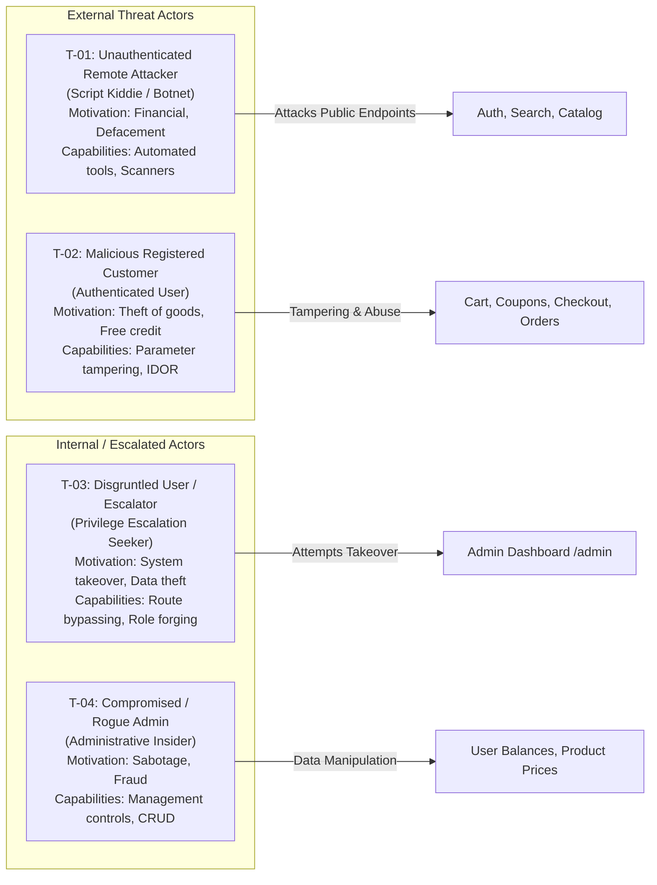
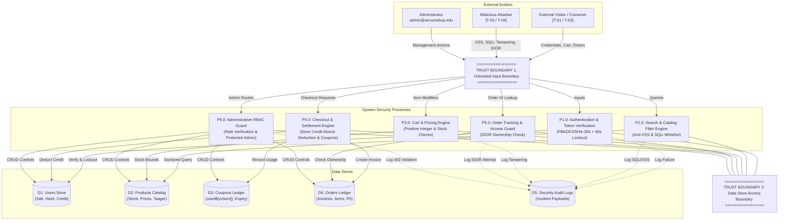

# 🎯 Threat Model & Risk Assessment Specification
## SecureShop E-Commerce System — Phase 1 Baseline

> **Institution:** Elsewedy University of Technology (Polytechnic of Egypt)  
> **Faculty:** Department of Computer Engineering Technology  
> **Course:** CET431 — Software Security | Fall 2026  
> **Milestone:** Project Phase 1 Submission & Week 10 Oral Defense (5 Marks)  
> **Document Identifier:** `SEC-TM-2026-PH1-V1.0`  
> **Developer:** Osama Mohamed Moawad Zaytoun (Student ID: 230105355)  
> **Implementation Mode:** Individual Project Implementation (Course standard team size: 6; subject to instructor approval)  
> **Methodology:** STRIDE (Microsoft Threat Modeling Standard) & OWASP Top 10 (2021)  
> **Artifact References:** DFD Vector Diagram in `docs/Phase1/diagrams/threat_model_dfd.svg`  

---

## 1. Identification of High-Value Assets

Assets in SecureShop are categorized in accordance with the **CIA Triad** (Confidentiality, Integrity, and Availability):

```
+----------------------------------------------------------------------------------------------------+
|                                    SYSTEM ASSET CLASSIFICATION                                     |
+----------------------------------+-----------------------------+-----------------------------------+
| Asset Identifier & Title         | Security Objective (CIA)     | Description & Impact of Compromise|
+----------------------------------+-----------------------------+-----------------------------------+
| **AST-01: User Credentials**    | Confidentiality & Integrity | Plaintext passwords, PBKDF2/SHA-256|
|                                  |                             | hashes, cryptographic salts, and  |
|                                  |                             | 6-digit confirmation tokens.      |
| **AST-02: Authenticated Sessions**| Confidentiality & Integrity | Client session tokens, active user|
|                                  |                             | profile objects in memory/storage.|
| **AST-03: Customer PII Data**    | Confidentiality             | Customer real names, phone numbers,|
|                                  |                             | governorates, detailed addresses, |
|                                  |                             | and order history invoices.       |
| **AST-04: Store Credit Balances**| Integrity & Accountability  | Customer digital wallet ledger    |
|                                  |                             | (`storeCredit`) denominated in EGP.|
| **AST-05: Product Catalog & Stock**| Integrity & Availability  | Live retail prices, stock units,  |
|                                  |                             | wholesale Taager drop costs, specs|
| **AST-06: Promotional Coupons**  | Integrity & Financial       | Promotional codes, discount % caps|
|                                  |                             | and customer redemption ledgers.  |
| **AST-07: Admin Privileges**     | Integrity & Availability    | Role assignments, administrative  |
|                                  |                             | control capabilities on `/admin`. |
| **AST-08: Security Audit Logs**  | Integrity & Non-Repudiation | Historical incident records,      |
|                                  |                             | timestamps, intercepted payloads. |
| **AST-09: Database Schema & DB** | Integrity & Availability    | Remote PostgreSQL tables, fields,  |
|                                  |                             | constraints, and connection strings|
+----------------------------------+-----------------------------+-----------------------------------+
```

---

## 2. Threat Actor Characterization

The threat model identifies four primary threat agents with varying capabilities, motivations, and access levels:



### 2.1 Threat Actor Profiles
- **T-01: Unauthenticated Remote Attacker (Opportunist / Automated Scanner):**
  - **Access Level:** Zero credentials. Operates from external network boundaries.
  - **Attack Vectors:** Automated password brute-forcing, SQL injection probes in search parameters, reflected XSS payloads, credential stuffing.
- **T-02: Malicious Authenticated Customer:**
  - **Access Level:** Valid standard account credentials (`role: 'user'`).
  - **Attack Vectors:** Insecure Direct Object Reference (IDOR) by modifying invoice order identifiers, parameter tampering in shopping cart quantities (negative or zero quantities), promotional coupon replay attacks, email mismatch spoofing in newsletter claims.
- **T-03: Disgruntled User Seeking Privilege Escalation:**
  - **Access Level:** Authenticated standard customer attempting vertical privilege escalation.
  - **Attack Vectors:** Direct URL navigation to `/admin`, tampering with local storage session objects (`role: 'admin'`), forging state variables to access administrative APIs.
- **T-04: Unauthorized / Compromised Administrator:**
  - **Access Level:** Attacker possessing compromised administrator credentials.
  - **Attack Vectors:** Deletion of other administrators, tampering with retail stock and wholesale pricing, arbitrary manipulation of user store credit balances.

---

## 3. Attack Surface Enumeration

Every functional interface represents an entry point that expands the application attack surface:

| Attack Surface ID | Entry Point Component | Associated Input Parameters | Associated Vulnerability Vectors |
|:---|:---|:---|:---|
| **AS-01** | Login Modal (`AuthModal.tsx`) | `loginEmail`, `loginPassword` | Brute force, credential stuffing, timing attacks, password enumeration. |
| **AS-02** | Registration Modal (`AuthModal.tsx`) | `regName`, `regEmail`, `regPassword` | Weak password policy, XSS in name field, email collisions. |
| **AS-03** | Account Confirmation (`AuthModal.tsx`) | `confirmEmail`, `confirmCode` | Token brute-forcing, OTP enumeration. |
| **AS-04** | Catalog Search Bar (`App.tsx`) | `searchQuery` (URL or text input) | Reflected XSS, SQL injection metacharacters, ReDoS. |
| **AS-05** | Cart Quantity Stepper (`CartDrawer.tsx`) | `quantity` input | Business logic: negative quantities (`-5`), fractional numbers, stock overflow. |
| **AS-06** | Coupon Input (`CartDrawer.tsx`, `CheckoutModal.tsx`) | `couponCode` | Coupon replay attacks, expired coupon exploitation, case manipulation. |
| **AS-07** | Newsletter Box (`NewsletterSection.tsx`) | `email` input | Email spoofing, privilege exploitation, multiple welcome code generation. |
| **AS-08** | Checkout Form (`CheckoutModal.tsx`) | Name, Phone, Governorate, Address, Payment Method | Stored XSS in address fields, store credit balance underflow, COD fraud. |
| **AS-09** | Order Tracking Lookup (`OrderTrackingModal.tsx`) | `trackingOrderId`, `phone` | IDOR / BOLA, customer PII data leakage, unauthorized order enumeration. |
| **AS-10** | User Profile Form (`UserProfileModal.tsx`) | Address, Phone, Old Password, New Password | Stored XSS, CSRF, password change without old password verification. |
| **AS-11** | Admin Panel (`AdminDashboard.tsx`) | Tab navigation, CRUD forms | Broken access control, vertical privilege escalation. |
| **AS-12** | Browser LocalStorage | `secureshop_*` keys | Client-side tampering of session state, privilege flags, and balances. |
| **AS-13** | Direct Supabase REST Endpoint | Supabase REST URL + Anon Key | Unauthenticated REST table queries bypassing frontend guards. |

---

## 4. Threat Model Data Flow Diagram (DFD Level 1)



> **Detailed Threat Model Vector Graphic:** A scalable SVG diagram is available at `docs/Phase1/diagrams/threat_model_dfd.svg`.

---

## 5. Comprehensive STRIDE Threat Analysis

Each threat is assessed using the **STRIDE** methodology, documenting real vulnerabilities in the naive baseline and the corresponding verified mitigations in the SecureShop codebase:

```
+----------------------------------------------------------------------------------------------------+
|                                    STRIDE THREAT SUMMARY TABLE                                     |
+--------+---------------------------------------+---------------+-----------------+-----------------+
| STRIDE | Threat Description                    | Risk Level    | Initial Status  | Final Status    |
+--------+---------------------------------------+---------------+-----------------+-----------------+
| S-01   | Credential Brute-Force & Password Guess| **High**      | Vulnerable      | **Mitigated**   |
| T-01   | Search Query & Parameter Manipulation | **High**      | Vulnerable      | **Mitigated**   |
| T-02   | Negative Cart Quantity Injection      | **High**      | Vulnerable      | **Mitigated**   |
| T-03   | Promotional Coupon Replay Manipulation| **Medium**    | Vulnerable      | **Mitigated**   |
| R-01   | Repudiation of Orders & Discount Usage| **Medium**    | Vulnerable      | **Mitigated**   |
| I-01   | Cross-Site Scripting (Reflected/Stored)| **High**      | Vulnerable      | **Mitigated**   |
| I-02   | Insecure Direct Object Reference (IDOR)| **High**      | Vulnerable      | **Mitigated**   |
| D-01   | Authentication Denial of Service      | **Medium**    | Vulnerable      | **Mitigated**   |
| E-01   | Vertical Privilege Escalation to Admin| **Critical**  | Vulnerable      | **Mitigated**   |
| E-02   | Administrative Role Tampering         | **High**      | Vulnerable      | **Mitigated**   |
+--------+---------------------------------------+---------------+-----------------+-----------------+
```

---

### 5.1 Spoofing (S)

#### Threat S-01: Automated Credential Guessing & Password Spoofing
- **Target Asset:** `AST-01: User Credentials`, `AST-02: Authenticated Sessions`.
- **Attack Surface:** `AS-01: Login Modal` (`AuthModal.tsx`).
- **Threat Actor:** `T-01: Unauthenticated Attacker`.
- **Root Cause (Naive Baseline):** The naive implementation allows unlimited rapid password submissions without tracking failed attempts, comparing passwords using weak unsalted hashing or plaintext.
- **Impact:** High. Account takeover, unauthorized access to customer wallet balances and order histories.
- **Likelihood:** High.
- **Risk Level:** **High (CVSS 7.8)**.
- **Implemented Mitigation:**
  1. Hashing using **PBKDF2 with SHA-256**, 100,000 iterations, and a unique 16-byte random salt per user (`src/security/securityService.ts`).
  2. Adaptive account lockout threshold: If 5 consecutive failed attempts occur on an account, `isLocked` is set to `true` and `lockUntil` is set to 60 seconds in the future (`src/context/StoreContext.tsx`, lines 758–769).
  3. Interactive countdown timer locks the login interface until the cooldown expires.
- **Implementation Status:** **Implemented & Verified**.
- **Code Evidence:** `src/context/StoreContext.tsx` (`login`), `src/security/securityService.ts` (`hashPasswordSecure`).

---

### 5.2 Tampering (T)

#### Threat T-01: SQL & Search Parameter Query Tampering
- **Target Asset:** `AST-05: Product Catalog & Stock`, `AST-09: Database Schema`.
- **Attack Surface:** `AS-04: Catalog Search Bar` (`searchQuery`).
- **Threat Actor:** `T-01: Unauthenticated Attacker`.
- **Root Cause (Naive Baseline):** Unsanitized user search terms are concatenated directly into filter expressions (`title LIKE '%" + input + "%'`), allowing SQL metacharacters (`'`, `--`, `UNION SELECT`, `OR 1=1`) to alter query logic.
- **Impact:** High. Deactivated products, hidden items, or unauthorized records leak into public search results.
- **Likelihood:** High.
- **Risk Level:** **High (CVSS 8.2)**.
- **Implemented Mitigation:**
  1. Whitelist pattern validation in `validateSearchQuery` (`src/security/securityService.ts`, lines 76–93).
  2. Intercepts SQL injection signatures: `/('|--|;|\/\*|\*\/|union\s+select|drop\s+table|insert\s+into|or\s+1=1)/i`.
  3. Strips illegal characters, triggers an on-screen warning toast, and logs a `SQL/Search Injection` event to `security_logs`.
- **Implementation Status:** **Implemented & Verified**.
- **Code Evidence:** `src/security/securityService.ts` (`validateSearchQuery`), `src/App.tsx` (lines 40–45).

#### Threat T-02: Negative Quantity Parameter Tampering in Shopping Cart
- **Target Asset:** `AST-04: Store Credit Balances`, `AST-05: Product Catalog & Stock`.
- **Attack Surface:** `AS-05: Cart Quantity Stepper` (`CartDrawer.tsx`).
- **Threat Actor:** `T-02: Malicious Registered Customer`.
- **Root Cause (Naive Baseline):** The application trusts client-submitted numerical values without validating that quantities are positive integers within physical inventory limits. Submitting a negative number (`-5`) mathematically reduces the subtotal, enabling fraudulent or free checkout.
- **Impact:** High. Direct financial loss, inventory ledger corruption.
- **Likelihood:** High.
- **Risk Level:** **High (CVSS 7.4)**.
- **Implemented Mitigation:**
  1. Numerical validation in `validateCartQuantity` (`src/security/securityService.ts`, lines 99–128).
  2. Verifies `!isNaN(parsed)`, `Number.isInteger(parsed)`, and `parsed > 0`.
  3. Validates `parsed <= stock`. Clamps invalid or negative quantities to `1` and emits an explicit alert.
- **Implementation Status:** **Implemented & Verified**.
- **Code Evidence:** `src/security/securityService.ts` (`validateCartQuantity`), `src/components/customer/CartDrawer.tsx`.

#### Threat T-03: Promotional Coupon Replay & Discount Tampering
- **Target Asset:** `AST-04: Store Credit`, `AST-06: Promotional Coupons`.
- **Attack Surface:** `AS-06: Coupon Input` (`CartDrawer.tsx`, `CheckoutModal.tsx`).
- **Threat Actor:** `T-02: Malicious Registered Customer`.
- **Root Cause (Naive Baseline):** Promotional discount codes (`WELCOME15`) are applied repeatedly across multiple orders because the system fails to record the customer identity on the coupon record.
- **Impact:** Medium. Unauthorized repeat discounts and margin erosion.
- **Likelihood:** High.
- **Risk Level:** **Medium (CVSS 5.3)**.
- **Implemented Mitigation:**
  1. Ledger tracking via `coupon.usedByUsers` (`src/types/coupon.ts`).
  2. Validation in `validateCouponSecurity`: Rejects redemption if `coupon.usedByUsers.includes(currentUser.id)` with an explicit `Coupon Replay Blocked` error.
  3. When an order is created, `currentUser.id` is permanently appended to `coupon.usedByUsers` and updated in Supabase.
- **Implementation Status:** **Implemented & Verified**.
- **Code Evidence:** `src/security/securityService.ts` (`validateCouponSecurity`), `src/context/StoreContext.tsx` (lines 1176–1180).

---

### 5.3 Repudiation (R)

#### Threat R-01: Repudiation of Completed Orders & Coupon Claims
- **Target Asset:** `AST-04: Store Credit Balances`, `AST-08: Security Audit Logs`.
- **Attack Surface:** `AS-08: Checkout Form`, `AS-07: Newsletter Widget`.
- **Threat Actor:** `T-02: Malicious Registered Customer`.
- **Root Cause (Naive Baseline):** Absence of persistent transaction histories, lack of customer binding on invoices, and missing security audit logs allow users to claim they never authorized balance deductions.
- **Impact:** Medium. Dispute resolution complexity, financial discrepancies.
- **Likelihood:** Low.
- **Risk Level:** **Medium (CVSS 4.8)**.
- **Implemented Mitigation:**
  1. Immutable order history records containing timestamped status transitions (`timeline: OrderStatusHistoryItem[]`).
  2. Strict binding of customer `userId` to the order document.
  3. Persistent `security_logs` capturing customer actions, payloads, and mitigation outcomes.
- **Implementation Status:** **Implemented & Verified**.
- **Code Evidence:** `src/context/StoreContext.tsx` (`createOrder`), `src/types/ecommerce.ts` (`OrderStatusHistoryItem`).

---

### 5.4 Information Disclosure (I)

#### Threat I-01: Cross-Site Scripting (XSS - Stored & Reflected)
- **Target Asset:** `AST-02: Authenticated Sessions`, `AST-03: Customer PII Data`.
- **Attack Surface:** `AS-04: Catalog Search Bar`, `AS-10: User Profile Form`.
- **Threat Actor:** `T-01: Unauthenticated Attacker`, `T-02: Malicious Customer`.
- **Root Cause (Naive Baseline):** User input is directly interpolated into DOM elements without entity encoding, allowing injected `<script>` tags or inline event handlers (``) to execute within victim browsers.
- **Impact:** High. Session token theft, UI defacement, credential harvesting.
- **Likelihood:** High.
- **Risk Level:** **High (CVSS 7.5)**.
- **Implemented Mitigation:**
  1. Mandatory HTML entity encoding in `sanitizeHtml` (`src/security/securityService.ts`, lines 53–70).
  2. Encodes special characters: `&` $\to$ `&amp;`, `<` $\to$ `&lt;`, `>` $\to$ `&gt;`, `"` $\to$ `&quot;`, `'` $\to$ `&#x27;`, `/` $\to$ `&#x2F;`.
  3. Strips malicious pseudo-protocols: `javascript:`, `onerror=`, `onload=`.
  4. React 19 JSX native text node escaping provides an additional defensive layer.
- **Implementation Status:** **Implemented & Verified**.
- **Code Evidence:** `src/security/securityService.ts` (`sanitizeHtml`).

#### Threat I-02: Insecure Direct Object Reference (IDOR) on Customer Invoices
- **Target Asset:** `AST-03: Customer PII Data` (Real names, phone numbers, addresses, purchase history).
- **Attack Surface:** `AS-09: Order Tracking Lookup` (`OrderTrackingModal.tsx`).
- **Threat Actor:** `T-02: Malicious Registered Customer`.
- **Root Cause (Naive Baseline):** The order tracking lookup accepts any order identifier (e.g., `#DK-1001`) and returns full customer details without verifying whether the requesting user owns the order.
- **Impact:** High. Massive customer privacy breach, exposure of phone numbers and physical delivery locations.
- **Likelihood:** High.
- **Risk Level:** **High (CVSS 7.7)**.
- **Implemented Mitigation:**
  1. Object-level authorization check in `validateOrderAccess` (`src/security/securityService.ts`, lines 134–169).
  2. Unauthenticated visitors are rejected (`403 Forbidden`).
  3. Authenticated customers are permitted if and only if `order.userId === currentUser.id` (or verified matching customer phone number).
  4. Administrators (`currentUser.role === 'admin'`) retain legitimate managerial review access.
  5. Any unauthorized attempt returns `403 Forbidden` and logs an IDOR violation in the Security Hub.
- **Implementation Status:** **Implemented & Verified**.
- **Code Evidence:** `src/security/securityService.ts` (`validateOrderAccess`), `src/context/StoreContext.tsx` (`getOrderById`).

---

### 5.5 Denial of Service (D)

#### Threat D-01: Authentication Service Exhaustion (Brute-Force DoS)
- **Target Asset:** `AST-01: User Credentials`, `AST-09: Database Engine`.
- **Attack Surface:** `AS-01: Login Modal`.
- **Threat Actor:** `T-01: Automated Botnet`.
- **Root Cause (Naive Baseline):** Heavy cryptographic operations (PBKDF2 with 100,000 iterations) executed without rate-limiting can cause client thread starvation when flooded with continuous requests.
- **Impact:** Medium. Browser tab unresponsiveness and resource exhaustion.
- **Likelihood:** Medium.
- **Risk Level:** **Medium (CVSS 5.3)**.
- **Implemented Mitigation:**
  1. Client-side lockout threshold halting hash computations after 5 failures for 60 seconds.
  2. Input debounce and disabled submit button during active cryptographic derivation.
- **Implementation Status:** **Implemented & Verified**.
- **Code Evidence:** `src/context/StoreContext.tsx` (`login`).

---

### 5.6 Elevation of Privilege (E)

#### Threat E-01: Vertical Privilege Escalation to Administrative Dashboard
- **Target Asset:** `AST-07: Admin Privileges`, `AST-05: Product Catalog`, `AST-04: Store Credit`.
- **Attack Surface:** `AS-11: Admin Panel` (`/admin` view).
- **Threat Actor:** `T-02: Malicious Registered Customer`, `T-03: Privilege Escalator`.
- **Root Cause (Naive Baseline):** The application relies on "Security through Obscurity" by simply hiding the navigation button in the header, without enforcing role checks when the component mounts. A normal customer who triggers the view state directly accesses full administrative powers.
- **Impact:** Critical. Full unauthorized administrative control: modifying prices, adjusting user balances, deleting accounts.
- **Likelihood:** High.
- **Risk Level:** **Critical (CVSS 9.1)**.
- **Implemented Mitigation:**
  1. Role-Based Access Control (RBAC) guard in `validateAdminAccess` (`src/security/securityService.ts`, lines 175–200).
  2. `AdminDashboard.tsx` evaluates access on mount: If `currentUser === null` or `currentUser.role !== 'admin'`, rendering is terminated immediately.
  3. Displays a full-screen `403 Access Denied` alert and logs a `Vertical Privilege Escalation Blocked` security event.
- **Implementation Status:** **Implemented & Verified**.
- **Code Evidence:** `src/components/admin/AdminDashboard.tsx` (lines 35–65), `src/security/securityService.ts` (`validateAdminAccess`).

#### Threat E-02: Unauthorized Administrative Role Promotion & Account Tampering
- **Target Asset:** `AST-07: Admin Privileges`, `AST-01: User Credentials`.
- **Attack Surface:** `AS-11: User Management Panel` (`UserManager.tsx`).
- **Threat Actor:** `T-03: Privilege Escalator`.
- **Root Cause (Naive Baseline):** Administrative interfaces allow any user to be promoted to `admin` or permit the sole administrator account to be demoted or deleted.
- **Impact:** High. Hostile administrative takeover, lock-out of legitimate store managers.
- **Likelihood:** Medium.
- **Risk Level:** **High (CVSS 7.2)**.
- **Implemented Mitigation:**
  1. **Sole Administrator Rule:** `admin@secureshop.edu` is permanently marked as a protected account (`حساب محمي 🛡️`).
  2. `updateUserRole` in `StoreContext.tsx` explicitly prohibits promoting any user to `admin` (`role === 'admin'` promotion blocked).
  3. Action buttons (Demote, Credit Adjustment, Suspend, Delete) are completely removed from the administrator row in `UserManager.tsx`.
- **Implementation Status:** **Implemented & Verified**.
- **Code Evidence:** `src/components/admin/UserManager.tsx`, `src/context/StoreContext.tsx` (`deleteUser`, `updateUserRole`).

---

## 6. Document Sign-Off & Threat Model Approval

This threat model reflects the verified architecture and defensive controls implemented within Phase 1 of SecureShop.

- **Developer & Sole Author:** Osama Mohamed Moawad Zaytoun
- **Student ID:** 230105355
- **Academic Course:** CET431 — Software Security
- **Department:** Computer Engineering Technology, Elsewedy University of Technology
- **Evaluation Milestone:** University Oral Defense — Week 10
- **Status:** Phase 1 Threat Model Approved
